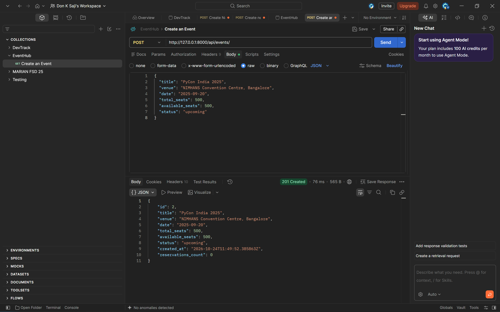
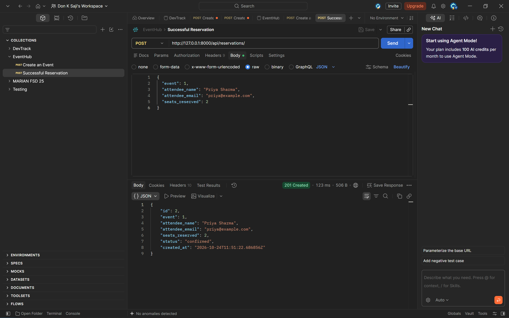
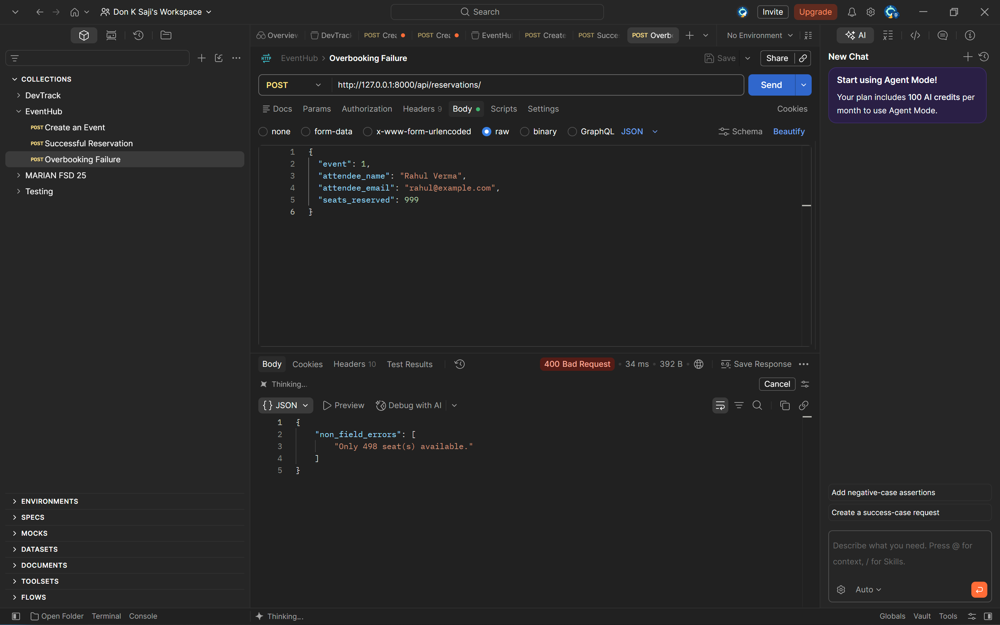
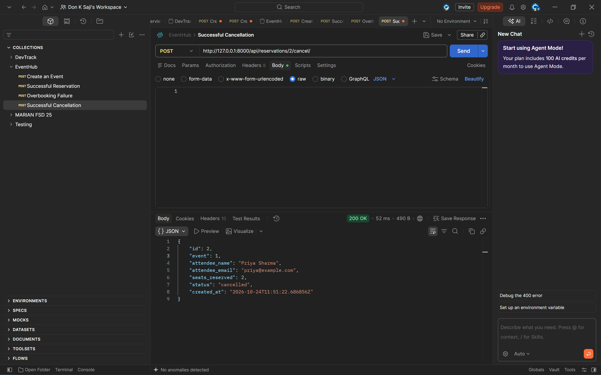

# EventHub - Event Ticketing & Reservation Backend API

**EventHub** is a clean, reliable Django REST backend API for an event ticketing and reservation platform built with Django, Django REST Framework (DRF), ViewSets, and a DefaultRouter. Users can browse events, book seat reservations with availability validation, and cancel reservations with automatic seat restoration.

This project was built as part of the **AI-First Backend Engineering** program at **AirTribe**.

---

## 📌 Architecture & Features

1. **Django ORM Domain Modeling (`events/models.py`)**:
   - **`Event` Model**: Stores event title, venue, date, total seats, available seats, and event lifecycle status (`upcoming`, `ongoing`, `completed`, `cancelled`). Ordered chronologically by `date`.
   - **`Reservation` Model**: Links to `Event` via ForeignKey (1:many relationship). Stores attendee name, attendee email, reserved seats count, and booking status (`confirmed`, `cancelled`). Ordered by newest first (`-created_at`).

2. **Robust DRF Serialization & Validation (`events/serializers.py`)**:
   - **`EventSerializer`**:
     - Includes a computed field `reservations_count` using `SerializerMethodField` to report active confirmed reservations.
     - Validates that `available_seats` cannot exceed `total_seats`.
   - **`ReservationSerializer`**:
     - Enforces minimum seat reservation (`seats_reserved >= 1`).
     - Validates that reservations can only be made for `upcoming` or `ongoing` events.
     - Enforces availability check (`seats_reserved <= available_seats`).
     - **Encapsulated Deduction**: Deducts `available_seats` from the associated event and creates the `Reservation` inside the same `create()` method.

3. **ViewSets & Clean URL Routing (`events/views.py` & `events/urls.py`)**:
   - **`EventViewSet` (`ModelViewSet`)**:
     - Filter events by status (`?status=upcoming`).
     - Case-insensitive search on venue (`?venue=bangalore`).
   - **`ReservationViewSet` (`ModelViewSet`)**:
     - Filter reservations by event (`?event_id=<id>`).
     - Custom `@action(detail=True, methods=['post'])` at `POST /api/reservations/{id}/cancel/` to cancel a reservation and restore reserved seats to the event's inventory. Rejects repeated cancellations with `400 Bad Request`.
   - **`DefaultRouter`**: Exposes clean RESTful endpoints under `/api/events/` and `/api/reservations/`.

4. **Request Logging Middleware (`events/middleware.py`)**:
   - Intercepts incoming requests and outgoing responses.
   - Logs method, URL path, HTTP status code, and execution duration in seconds to the terminal for every request.

---

## 💡 Key Design Decision

### Seat Inventory Deduction Inside Serializer `create()`
* **The Decision**: Seat deduction and reservation creation happen together inside `ReservationSerializer.create()`, rather than splitting the logic across the view and the serializer.
* **Why**:
  1. **Single Source of Truth**: Tying seat deduction directly to reservation creation keeps the rule *"a reservation exists if and only if its seats were deducted"* in a single place.
  2. **Clean Separation of Concerns**: ViewSets remain thin and declarative, while validation rules (checking event status and seat capacity) live inside the serializer's `validate()` method.
  3. **Concurrency in Production**: In this assignment, keeping both writes inside the serializer `create()` method is clean and sufficient. In a production system with high traffic and many concurrent users booking the final available seat simultaneously, this logic would be wrapped in `transaction.atomic()` with row-level locking to prevent race conditions.

---

## 🛠️ How to Set Up & Run the Project

### 1. Clone the Repository
```bash
git clone <your-github-repo-url>
cd EventHub
```

### 2. Create and Activate Virtual Environment
On Windows (PowerShell):
```powershell
python -m venv venv
.\venv\Scripts\Activate.ps1
```
On macOS/Linux:
```bash
python3 -m venv venv
source venv/bin/activate
```

### 3. Install Dependencies
```bash
pip install -r requirements.txt
```

### 4. Run Database Migrations
```bash
python manage.py makemigrations
python manage.py migrate
```

### 5. Run the Development Server
```bash
python manage.py runserver
```
The server will start at `http://127.0.0.1:8000/`.

---

## 🔌 API Endpoints Documentation

Base URL: `http://127.0.0.1:8000/api/`

### 1. Events API (`/api/events/`)

| Method | Endpoint | Description |
|---|---|---|
| `GET` | `/api/events/` | List all events (supports `?status=` and `?venue=` filters) |
| `POST` | `/api/events/` | Create a new event |
| `GET` | `/api/events/{id}/` | Retrieve an event by ID (includes `reservations_count`) |
| `PUT` | `/api/events/{id}/` | Update all fields of an event |
| `PATCH` | `/api/events/{id}/` | Partially update an event |
| `DELETE` | `/api/events/{id}/` | Delete an event |

#### 🟢 Create Event — `POST /api/events/`
* **Request Body**:
  ```json
  {
    "title": "PyCon India 2025",
    "venue": "NIMHANS Convention Centre, Bangalore",
    "date": "2025-09-20",
    "total_seats": 500,
    "available_seats": 500,
    "status": "upcoming"
  }
  ```
* **Response (`201 Created`)**:
  ```json
  {
    "id": 1,
    "title": "PyCon India 2025",
    "venue": "NIMHANS Convention Centre, Bangalore",
    "date": "2025-09-20",
    "total_seats": 500,
    "available_seats": 500,
    "status": "upcoming",
    "created_at": "2026-10-24T10:26:24.175196Z",
    "reservations_count": 0
  }
  ```

#### 🔍 Filter Events
* **Filter by Status**: `GET /api/events/?status=upcoming`
* **Filter by Venue**: `GET /api/events/?venue=nimhans` (case-insensitive substring match)

---

### 2. Reservations API (`/api/reservations/`)

| Method | Endpoint | Description |
|---|---|---|
| `GET` | `/api/reservations/` | List all reservations (supports `?event_id=` filter) |
| `POST` | `/api/reservations/` | Reserve seats for an event |
| `GET` | `/api/reservations/{id}/` | Retrieve reservation details |
| `POST` | `/api/reservations/{id}/cancel/` | Custom action: Cancel reservation and restore seats |

#### 🟢 Reserve Seats — `POST /api/reservations/`
* **Request Body**:
  ```json
  {
    "event": 1,
    "attendee_name": "Priya Sharma",
    "attendee_email": "priya@example.com",
    "seats_reserved": 2
  }
  ```
* **Response (`201 Created`)**:
  ```json
  {
    "id": 1,
    "event": 1,
    "attendee_name": "Priya Sharma",
    "attendee_email": "priya@example.com",
    "seats_reserved": 2,
    "status": "confirmed",
    "created_at": "2026-10-24T10:26:24.220585Z"
  }
  ```

#### 🔴 Overbooking Attempt — `POST /api/reservations/`
* **Response (`400 Bad Request`)**:
  ```json
  {
    "non_field_errors": [
      "Only 1 seat(s) available."
    ]
  }
  ```

#### 🔴 Non-Active Event Attempt — `POST /api/reservations/`
* **Response (`400 Bad Request`)**:
  ```json
  {
    "non_field_errors": [
      "Cannot reserve seats for a completed event."
    ]
  }
  ```

#### 🟡 Cancel Reservation — `POST /api/reservations/{id}/cancel/`
* **Request Body**: None required.
* **Response (`200 OK`)**:
  ```json
  {
    "id": 1,
    "event": 1,
    "attendee_name": "Priya Sharma",
    "attendee_email": "priya@example.com",
    "seats_reserved": 2,
    "status": "cancelled",
    "created_at": "2026-10-24T10:26:24.220585Z"
  }
  ```
* **Already Cancelled Error (`400 Bad Request`)**:
  ```json
  {
    "error": "Already cancelled."
  }
  ```

#### 🔍 Filter Reservations
* **Filter by Event ID**: `GET /api/reservations/?event_id=1`

---

## 📋 Middleware Terminal Logging

The custom `RequestLoggingMiddleware` automatically logs every incoming HTTP request and outgoing response status and duration:

```text
2026-10-24 19:39:12,970 [INFO] events.middleware: POST /api/reservations/1/cancel/ - 200 - 0.02s
2026-10-24 19:39:12,971 [INFO] events.middleware: POST /api/reservations/1/cancel/ - 400 - 0.00s
2026-10-24 19:39:12,976 [INFO] events.middleware: POST /api/events/ - 201 - 0.00s
2026-10-24 19:39:12,992 [INFO] events.middleware: POST /api/reservations/ - 201 - 0.02s
2026-10-24 19:39:12,996 [INFO] events.middleware: GET /api/events/ - 200 - 0.00s
```

---

## 📸 Postman Testing & Screenshots

### 1. Create an Event (`201 Created`)


### 2. Successful Reservation (`201 Created`)


### 3. Overbooking Failure (`400 Bad Request`)


### 4. Successful Cancellation (`200 OK`)


---

## 📂 Project Directory Structure

```text
eventhub/
├── manage.py
├── requirements.txt
├── README.md
├── db.sqlite3
├── .gitignore
├── eventhub/
│   ├── __init__.py
│   ├── asgi.py
│   ├── settings.py
│   ├── urls.py
│   └── wsgi.py
├── events/
│   ├── __init__.py
│   ├── admin.py
│   ├── apps.py
│   ├── middleware.py
│   ├── models.py
│   ├── serializers.py
│   ├── tests.py
│   ├── urls.py
│   ├── views.py
│   └── migrations/
│       ├── __init__.py
│       └── 0001_initial.py
└── screenshots/
    ├── 01_create_event.png
    ├── 02_successful_reservation.png
    ├── 03_overbooking_failure.png
    └── 04_successful_cancellation.png
```
